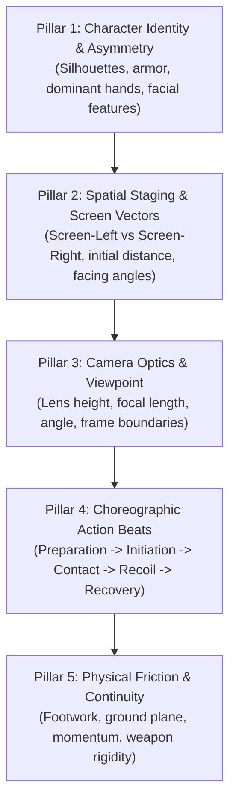
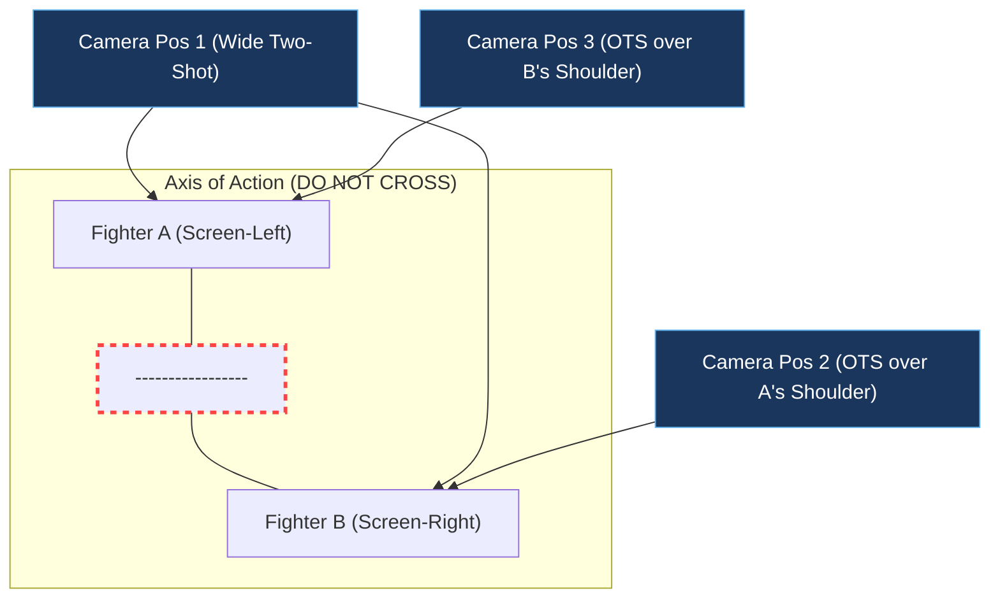
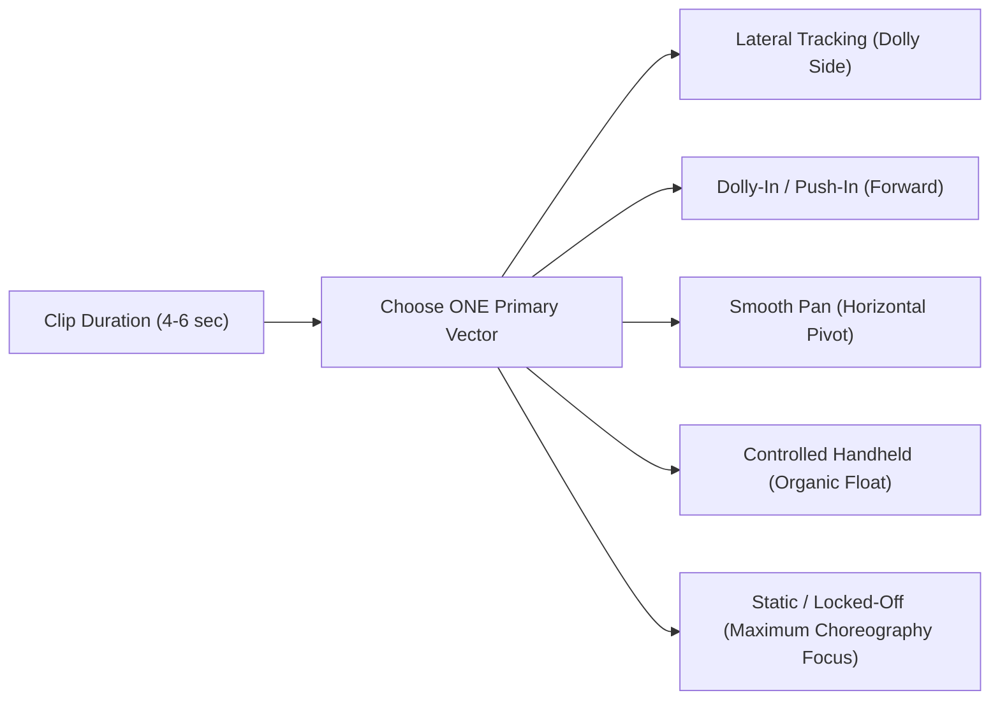
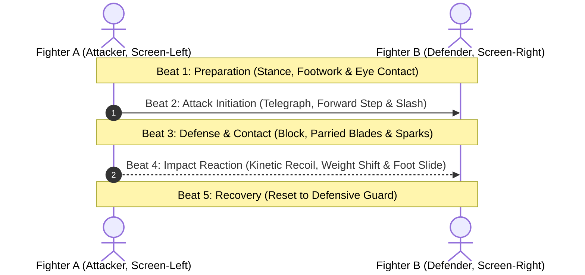
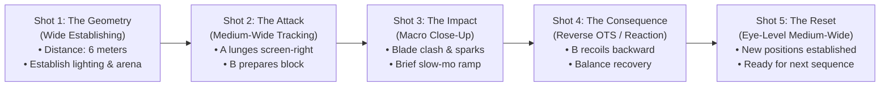

# The Director’s Lens: The Definitive Guide to Camera Settings, Angles, and Character Blocking in AI Video Generation

> **Subtitle:** *Stop the morphing, command 3D space, master the 180° rule, and direct photorealistic action scenes in Botock, Flow AI, Kling, Sora, Luma Dream Machine, and Runway Gen-3.*

<!-- Structured Data: TechArticle & FAQPage Schema (JSON-LD) for Search Engines -->
<script type="application/ld+json">
{
  "@context": "https://schema.org",
  "@graph": [
    {
      "@type": "TechArticle",
      "headline": "The Ultimate Guide to Camera Settings, Angles, and Character Blocking in AI Video Generation",
      "alternativeHeadline": "How to Command 3D Space and Direct Photorealistic Action Scenes in AI Video Models",
      "description": "Comprehensive masterclass on camera settings, lens optics, spatial character blocking, the 180-degree axis, and choreographic prompt engineering for generative AI video models.",
      "image": "https://images.openai.com/static-rsc-4/hP0untLbceFU2hr14K28Qt0OaT7aD_o28ifdK_8jKj7zPSWwcDgHvdofG1642lCjqoFOUbwPGgbrOFYRaqcOLBuqcm2zy4zOlykQF41Fk8Pgxs_4aTM-Bhmmr9LsnB_rjSi90B1lfBa99B4vQlp-TKPXqZQ8jFNVj-Gk0mXNVgHrQ-IqCAHKcEAuFFM5aF1F?purpose=fullsize",
      "author": {
        "@type": "Organization",
        "name": "Botock AI"
      },
      "publisher": {
        "@type": "Organization",
        "name": "Botock",
        "logo": {
          "@type": "ImageObject",
          "url": "https://botock.com/logo.png"
        }
      },
      "datePublished": "2026-10-12",
      "dateModified": "2026-10-12",
      "mainEntityOfPage": "https://botock.com/blog/camera-settings-ai-video-generation-guide"
    },
    {
      "@type": "FAQPage",
      "mainEntity": [
        {
          "@type": "Question",
          "name": "Why do weapons and characters morph during AI video generation?",
          "acceptedAnswer": {
            "@type": "Answer",
            "text": "Weapons and characters morph because video diffusion models operate probabilistically on 2D latent frames. When prompt instructions omit explicit screen coordinates (screen-left vs. screen-right), hand assignments, and rigid physical collision constraints, the model blends character features together across time steps."
          }
        },
        {
          "@type": "Question",
          "name": "What is the single most important rule for camera blocking in AI video?",
          "acceptedAnswer": {
            "@type": "Answer",
            "text": "The Screen-Left vs. Character-Left rule. Always specify positions relative to the camera lens (screen-left, screen-right, frame center) rather than the character's anatomical left or right, which eliminates coordinate ambiguity in the AI's spatial computation."
          }
        },
        {
          "@type": "Question",
          "name": "How does the 180-degree rule apply to AI video prompts?",
          "acceptedAnswer": {
            "@type": "Answer",
            "text": "The 180-degree rule ensures the camera stays on one side of the imaginary line running between two characters across consecutive shots. In AI video prompting, you must enforce this by maintaining the same character on screen-left and the opponent on screen-right across sequential clips so the audience does not experience disorienting position flips."
          }
        },
        {
          "@type": "Question",
          "name": "Can you combine multiple camera movements in a single AI video prompt?",
          "acceptedAnswer": {
            "@type": "Answer",
            "text": "No. Combining multiple camera movements (e.g., pan + orbit + zoom + tilt) almost always collapses the model's 3D coherence, causing melted backgrounds and rubbery limbs. Follow the Single-Vector Principle: choose one primary movement per 4-to-6 second clip."
          }
        }
      ]
    }
  ]
}
</script>

---

## Executive Summary: The AI Cinematographer's Dilemma

If you have spent any time attempting to generate cinematic action scenes using AI video models—whether on **Botock**, **Flow AI**, **Runway Gen-3 Alpha**, **Kling AI**, **Luma Dream Machine**, or **OpenAI Sora**—you have inevitably run into the "Fever Dream Phenomenon":
- Swords magically morph into hands or swap arms midway through a swing.
- Two warriors begin facing each other, but three frames later they are spinning in disjointed circles or merging into a two-headed abomination.
- The camera frantically orbits, zooms, and whip-pans simultaneously, leaving your audience disoriented and nauseous.
- You typed `"epic cinematic fighting scene, photorealistic, 8k, Unreal Engine 5 render, Hollywood movie"`, and the AI gave you a blurry, chaotic soup.

Here is the fundamental reality that separates amateur prompters from professional AI filmmakers:

> [!IMPORTANT]
> **AI video models are not human directors; they are high-dimensional probabilistic simulators.**
> When you feed an AI video generator vague adjectives like *"epic"*, *"insane"*, or *"hyper-detailed"*, the model draws from a broad distribution of random cinematic imagery. But when you describe **Euclidean spatial coordinates**, **lens focal heights**, **screen-vector directions**, and **sequential choreography beats**, the model is constrained into a coherent physical simulation.

---

### Key Takeaways (SEO Quick Answer)
- **Coordinate Precision:** Never write *"Fighter A steps to his left."* Always use **Screen-Left** and **Screen-Right** coordinates from the camera's perspective.
- **The Single-Vector Law:** Restrict each 5-second video clip to **one primary camera movement** (e.g., tracking OR dolly-in, never both with rapid pans).
- **The 180° Axis:** Keep Fighter A on screen-left and Fighter B on screen-right across all consecutive cuts to prevent jarring character swaps.
- **Choreography Beats:** Split actions into a 5-beat cadence (*Preparation $\rightarrow$ Attack Initiation $\rightarrow$ Defense/Contact $\rightarrow$ Impact Reaction $\rightarrow$ Recovery*).
- **Visual Asymmetry:** Differentiate combatants with contrasting silhouettes, colors, and explicit weapon hands to prevent limb and texture blending.

---

## Table of Contents
1. [The 5-Pillar Architecture of a Cinematic AI Video Prompt](#1-the-5-pillar-architecture-of-a-cinematic-ai-video-prompt)
2. [Spatial Blocking & Geometry: The Rules That Prevent AI Hallucinations](#2-spatial-blocking--geometry-the-rules-that-prevent-ai-hallucinations)
   - [The Screen-Left vs. Character-Left Golden Rule](#the-screen-left-vs-character-left-golden-rule)
   - [The 3 Depth Planes: Foreground, Midground, Background](#the-3-depth-planes-foreground-midground-background)
   - [The 180-Degree Rule (The Axis of Action) in AI Video](#the-180-degree-rule-the-axis-of-action-in-ai-video)
3. [The Complete 12 Camera Angles & Framing Masterclass](#3-the-complete-12-camera-angles--framing-masterclass)
   - [1. Eye-Level Shot (Neutral Observer)](#1-eye-level-shot)
   - [2. Low Angle Shot (Heroism & Dominance)](#2-low-angle-shot)
   - [3. High Angle Shot (Vulnerability & Scale)](#3-high-angle-shot)
   - [4. Bird's-Eye / Top-Down View (God's Eye)](#4-birds-eye--top-down-view)
   - [5. Dutch Angle / Canted Tilt (Psychological Chaos)](#5-dutch-angle--canted-tilt)
   - [6. Wide / Establishing Shot (World-Building)](#6-wide--establishing-shot)
   - [7. Medium Two-Shot (Duel Standoff)](#7-medium-two-shot)
   - [8. Over-The-Shoulder (OTS) Shot (Combat Engagement)](#8-over-the-shoulder-ots-shot)
   - [9. Reverse Over-The-Shoulder (Reverse OTS)](#9-reverse-over-the-shoulder-reverse-ots)
   - [10. Close-Up (CU) (Micro-Expressions)](#10-close-up-cu)
   - [11. Extreme Close-Up / Impact Insert (ECU)](#11-extreme-close-up--impact-insert-ecu)
   - [12. Point-Of-View (POV) Shot (First-Person Immersion)](#12-point-of-view-pov-shot)
4. [Directing Virtual Camera Movement: The Single-Vector Principle](#4-directing-virtual-camera-movement-the-single-vector-principle)
5. [Choreography & Kinetic Beats: The 5-Beat Action Framework](#5-choreography--kinetic-beats-the-5-beat-action-framework)
6. [Special Effects Directing: Elemental Magic & Creature Battles](#6-special-effects-directing-elemental-magic--creature-battles)
7. [The 5-Shot Modular Scene Pipeline for 10-Second Clips](#7-the-5-shot-modular-scene-pipeline-for-10-second-clips)
8. [The Production-Ready Master Prompt Template](#8-the-production-ready-master-prompt-template)
9. [Pre-Flight Verification Checklist](#9-pre-flight-verification-checklist)
10. [Frequently Asked Questions (FAQ)](#10-frequently-asked-questions-faq)

---

## 1. The 5-Pillar Architecture of a Cinematic AI Video Prompt

To force an AI video generator into producing clean, physically grounded action, every prompt must be engineered using five structural layers. If any single pillar is omitted, the model will invent its own solution—and that solution is almost always a hallucinated glitch.



### Pillar 1: Character Identity & Asymmetry
AI models get confused when two characters look alike. If both fighters wear generic dark armor and hold generic swords, the model will fuse their limbs or swap their weapons across frames.
- **Rule of Visual Asymmetry:** Always give characters distinct silhouettes, contrasting color palettes, and explicit weapon hands.
  - *Fighter A:* Dark charcoal gambeson, silver short-cropped hair, steel broadsword held in his right hand.
  - *Fighter B:* Tan leather armor with crimson pauldrons, braided black hair, dual daggers held in both hands.

<figure align="center" style="margin: 16px auto; text-align: center; max-width: 380px;">
  
  <figcaption style="font-size: 0.78rem; color: #94a3b8; margin-top: 6px; font-style: italic; line-height: 1.35;">
    📸 <strong>Visual Reference:</strong> Pillar 1: Defining character identity, costume materials, and weapon hands creates visual asymmetry that prevents character morphing.
  </figcaption>
</figure>

### Pillar 2: Spatial Staging & Screen Vectors
Never write `"two warriors fighting"`. You must block the scene as if placing actors on a physical soundstage:
- Where does Fighter A start? (e.g., *Camera screen-left*).
- Where does Fighter B start? (e.g., *Camera screen-right*).
- What is their initial separation? (e.g., *Three meters apart*).
- Which direction are their chests and eyelines facing? (e.g., *Both face inward toward frame center*).

<figure align="center" style="margin: 16px auto; text-align: center; max-width: 380px;">
  
  <figcaption style="font-size: 0.78rem; color: #94a3b8; margin-top: 6px; font-style: italic; line-height: 1.35;">
    📸 <strong>Visual Reference:</strong> Pillar 2: Establishing spatial vectors and initial distance across screen-left and screen-right coordinates anchors the 3D scene.
  </figcaption>
</figure>

### Pillar 3: Camera Optics & Viewpoint
Specify the camera's physical height, angle of elevation, and distance:
- Avoid buzzwords like `"cinematic view"`.
- Use precise descriptions: `"Medium-wide shot at waist height, eye-level lens, stable 35mm perspective, 16:9 landscape aspect ratio."`

<figure align="center" style="margin: 16px auto; text-align: center; max-width: 380px;">
  
  <figcaption style="font-size: 0.78rem; color: #94a3b8; margin-top: 6px; font-style: italic; line-height: 1.35;">
    📸 <strong>Visual Reference:</strong> Pillar 3: Specifying optical coordinates—such as camera elevation, tilt angle, and focal length—controls the spatial perspective.
  </figcaption>
</figure>

### Pillar 4: Choreographic Action Beats
Video generators struggle with open-ended duration. If you write `"they have a long sword fight"`, the model tries to compress 20 moves into 5 seconds, resulting in erratic, jittery speeds. 
- Restrict each clip to **one or two clean action beats** (e.g., *Fighter A steps forward with a diagonal slash; Fighter B raises his blade to parry; blades lock momentarily with visible recoil*).

<figure align="center" style="margin: 16px auto; text-align: center; max-width: 380px;">
  
  <figcaption style="font-size: 0.78rem; color: #94a3b8; margin-top: 6px; font-style: italic; line-height: 1.35;">
    📸 <strong>Visual Reference:</strong> Pillar 4: Breaking combat into distinct beats (attack initiation, physical block, and blade lock) prevents chaotic speed warping.
  </figcaption>
</figure>

### Pillar 5: Physical Friction & Environmental Continuity
Remind the model of physical laws to anchor the animation:
- Footing must remain planted on the terrain (mud, cobblestone, snow).
- Weapon blades must remain rigid and not bend or pass through solid bodies.
- Include atmospheric interaction (dust kicked up by boots, sparks at blade collision, displaced air).

<figure align="center" style="margin: 16px auto; text-align: center; max-width: 380px;">
  
  <figcaption style="font-size: 0.78rem; color: #94a3b8; margin-top: 6px; font-style: italic; line-height: 1.35;">
    📸 <strong>Visual Reference:</strong> Pillar 5: Ground plane friction, realistic recoil physics, and particulate displacement ensure believable kinetic consequences.
  </figcaption>
</figure>

---

## 2. Spatial Blocking & Geometry: The Rules That Prevent AI Hallucinations

Before selecting a camera angle, you must understand the mathematical coordinate space of the video generator's canvas.

### The Screen-Left vs. Character-Left Golden Rule

> [!CAUTION]
> **The #1 mistake AI creators make is writing "Fighter A steps to his left."**  
> To a human actor, "my left" is an anatomical direction. But to an AI video model generating pixels across a 2D plane, "his left" creates an ambiguous coordinate conflict between the character's anatomical orientation and the camera's viewpoint.

**The Fix:** Always specify **Camera Frame Coordinates (Screen-Left / Screen-Right)**.

| Ambiguous Instruction (Causes Glitches) | Grounded Instruction (Rock-Solid Continuity) |
|---|---|
| *"Fighter A moves to his right and attacks B on his left."* | *"Fighter A begins on screen-left facing screen-right. Fighter B stands on screen-right facing screen-left. A lunges laterally toward screen-right."* |
| *"The camera moves around the hero."* | *"The camera remains stationary on the south side of the fighters, tracking laterally from screen-left to screen-right."* |
| *"The swordsman blocks with his left hand."* | *"Fighter B holds his buckler in his left hand (facing screen-left) and raises it to chest height to intercept the strike."* |

---

### The 3 Depth Planes: Foreground, Midground, Background

A flat AI video looks artificial. To achieve true cinematic depth, divide your scene into three explicit planes:

```
+---------------------------------------------------------------+
|  BACKGROUND: Distant castle ruins, overcast stormy sky, trees  |
|                                                               |
|  MIDGROUND (The Fight Zone):                                  |
|  [Fighter A on Screen-Left] <--- 3m ---> [Fighter B on Right] |
|                                                               |
|  FOREGROUND: Crumbling stone parapet, blades of wet grass     |
+---------------------------------------------------------------+
                             ▲
                             |
                       [CAMERA POSITION]
```

1. **Foreground (Near Plane):** Elements close to the lens (e.g., an over-the-shoulder silhouette, an out-of-focus cobblestone wall, weapon tips). Creates depth and immersion.
2. **Midground (Combat Plane):** Where the characters stand, move, clash, and recover. This zone must have clear negative space between the fighters so their silhouettes never bleed into each other.
3. **Background (Context Plane):** Anchors the physical geography (castle gates, forest canopy, burning torchlight). Prevents the AI from generating a generic blank void.

---

### The 180-Degree Rule (The Axis of Action) in AI Video

In classical filmmaking, the **180-degree rule** states that an invisible straight line runs between the two interacting characters (the *Axis of Action*). The camera must always remain on **one side of this line** across consecutive shots.

<figure align="center" style="margin: 16px auto; text-align: center; max-width: 380px;">
  
  <figcaption style="font-size: 0.78rem; color: #94a3b8; margin-top: 6px; font-style: italic; line-height: 1.35;">
    📸 <strong>Visual Reference:</strong> The 180-Degree Axis of Action: Keep camera setups on the same side of the imaginary line to prevent disorienting character swaps.
  </figcaption>
</figure>



**Why this breaks AI generation:**
If Shot 1 has Fighter A on screen-left attacking screen-right, and Shot 2 accidentally places the camera behind Fighter B without establishing the movement, Fighter A will suddenly appear on screen-right attacking screen-left. 
To the human viewer, it appears as though the characters teleported into each other's shoes.

**The Golden Prompting Rule:**
> In your prompts, always declare:
> `"Maintain strict screen direction: Fighter A remains anchored on screen-left, Fighter B remains anchored on screen-right. Do not cross the 180-degree axis."`

---

## 3. The Complete 12 Camera Angles & Framing Masterclass

Below is the exhaustive masterclass breakdown of all 12 fundamental camera angles and shot types, complete with visual references, optical configurations, narrative psychology, blocking formulas, common AI errors, and production-tested prompts.

---

### 1. Eye-Level Shot
*The Neutral Observer*

```
     [Eye-Level Horizon Line]
      ┌────────────────────┐
  o   │     o        o     │   o
 /|\  │    /|\      /|\    │  /| / \  │    / \      / \    │  /       └────────────────────┘
  Camera directly level with subject's eyes (approx 1.6m high)
```

- **Technical Definition & Optics:** The camera is positioned at standard human standing height (1.5 to 1.7 meters off the ground), parallel to the horizon with zero tilt. Natural 35mm to 50mm focal perspective.
- **Psychological Purpose & Emotional Impact:** Objective, grounded, and democratic. It puts the viewer on equal footing with the characters. It feels realistic, honest, and unmanipulated—ideal for dialogue, tense standoffs, and technical martial arts choreography where readability is paramount.
- **Visual Staging & Character Blocking:** Both Fighter A (screen-left) and Fighter B (screen-right) occupy equal vertical weight. The horizon bisects the upper third of their torsos. Their eyelines meet straight across the horizontal axis.
- **What Works Best:** Use this for clean combat readability. It is the easiest angle for AI models to compute because it avoids complex perspective distortion.
- **Common Mistakes & AI Pitfalls:** Using vague descriptions like `"normal shot"`. AI models often default to generic portrait framing. If you don't specify the distance between fighters, they will drift into each other.
- **Weak vs. Production Prompt:**
  - ❌ *Weak:* `"Eye level camera of two knights sword fighting."`
  - ✅ *Production-Ready:* `"Cinematic live-action fantasy duel, eye-level neutral perspective at 1.6 meters height. Camera is leveled with horizontal zero tilt. Fighter A stands on screen-left in three-quarter profile facing screen-right; Fighter B stands on screen-right facing screen-left. Three meters of clear cobblestone separates them. Realistic natural lighting, stable horizon, no perspective distortion."`

---

### 2. Low Angle Shot
*Power, Heroism, and Looming Threat*

<figure align="center" style="margin: 16px auto; text-align: center; max-width: 380px;">
  
  <figcaption style="font-size: 0.78rem; color: #94a3b8; margin-top: 6px; font-style: italic; line-height: 1.35;">
    📸 <strong>Visual Reference:</strong> Low Angle Shot: Camera positioned close to the terrain looking upward emphasizes heroic dominance, towering scale, and vertical momentum.
  </figcaption>
</figure>

- **Technical Definition & Optics:** The camera is positioned low to the ground (between 20 cm and 60 cm above the terrain) and tilted upward at an angle of 20° to 45° toward the subject.
- **Psychological Purpose & Emotional Impact:** Psychological dominance, monumental scale, heroism, and intimidation. The subject towers over the frame, making them appear invincible, god-like, or terrifying. In action sequences, it accentuates upward weapon swings and heroic leaps.
- **Visual Staging & Character Blocking:** The dominant character (Hero or Villain) dominates the center or screen-left, their head breaking the upper frame line against the sky or ceiling. The ground plane recedes steeply. Opponents or background elements appear diminutive below them.
- **What Works Best:** Pair with wide focal lengths (24mm or 28mm look) to emphasize verticality. Specify clean sky or towering architecture behind the subject to create high contrast.
- **Common Mistakes & AI Pitfalls:** Over-tilting the camera (`"extreme worm's eye view"`), which causes the AI to warp human anatomy into rubbery, elongated limbs or create gigantic boots with tiny heads.
- **Weak vs. Production Prompt:**
  - ❌ *Weak:* `"Low angle epic shot of warrior raising giant sword."`
  - ✅ *Production-Ready:* `"Cinematic low-angle medium shot, camera positioned 40 cm above the stone floor, tilted upward 30 degrees toward Fighter A. Fighter A stands on screen-left, towering heroically against an overcast stormy sky, holding a steel broadsword aloft in his right hand. Preserve natural human anatomy and proportions without fisheye distortion. Fighter B is visible in the lower screen-right background, diminutive and braced defensively. Dramatic cinematic backlight, dust particles drifting upward."`

---

### 3. High Angle Shot
*Vulnerability, Isolation, and Tactical Disadvantage*

```
   [CAMERA MOUNTED HIGH: 3m]
             │
             ▼ Tilted Downward 45°
          ┌────────────────────┐
          │        / \         │
          │       / | \        │
          │         o          │
          └────────────────────┘
```

- **Technical Definition & Optics:** The camera is positioned high above eye level (2.5 to 4 meters high) and angled downward at a 30° to 60° tilt, looking down upon the subjects.
- **Psychological Purpose & Emotional Impact:** Conveys helplessness, entrapment, vulnerability, and insignificance. When a warrior is knocked to the ground or cornered against a castle wall, a high angle visually diminishes their authority and emphasizes their peril.
- **Visual Staging & Character Blocking:** The defender or knocked-down character occupies the lower-center of the frame, surrounded by expansive ground texture (mud, cracked flagstones, blood spatters). The aggressor can loom in the foreground upper edge.
- **What Works Best:** Excellent for moments of defeat, disarming, or showing the aftermath of a massive kinetic blow.
- **Common Mistakes & AI Pitfalls:** AI often confuses `"high angle"` with a top-down aerial map view. Always specify that character bodies, faces, and limbs remain visible in three-dimensional perspective, not flattened.
- **Weak vs. Production Prompt:**
  - ❌ *Weak:* `"High angle of defeated warrior on ground."`
  - ✅ *Production-Ready:* `"Cinematic high-angle shot from an elevation of 3 meters, camera tilted downward 45 degrees. Fighter B is on one knee in the lower screen-right quadrant, clutching his injured shoulder, looking upward in alarm. The cracked stone courtyard fills the frame below him. Fighter A's back and sword-tip loom in the upper screen-left foreground. Harsh dramatic downlighting, realistic dirt, physical vulnerability, no top-down flattening."`

---

### 4. Bird's-Eye / Top-Down View
*God's Eye and Arena Geography*

<figure align="center" style="margin: 16px auto; text-align: center; max-width: 380px;">
  
  <figcaption style="font-size: 0.78rem; color: #94a3b8; margin-top: 6px; font-style: italic; line-height: 1.35;">
    📸 <strong>Visual Reference:</strong> Bird's-Eye / Overhead View: Looking directly down into the circular stone arena reveals combat geometry, encirclement, and tactical footwork.
  </figcaption>
</figure>

- **Technical Definition & Optics:** A 90-degree perpendicular overhead shot looking directly down at the ground plane from above. Zero horizontal horizon visible.
- **Psychological Purpose & Emotional Impact:** Detached, analytical, and tactical. It strips away emotional intimacy and transforms the confrontation into an abstract chess match. It communicates environmental entrapment, arena geometry, and tactical circling.
- **Visual Staging & Character Blocking:** Fighter A and Fighter B appear as distinct silhouettes circling each other clockwise around a central circular stone arena. Shadows stretch across the floor. Weapons are viewed from above.
- **What Works Best:** Ideal for showing complex tactical positioning, encirclement by multiple enemies, or magical runes activating across the floor.
- **Common Mistakes & AI Pitfalls:** AI video generators frequently hallucinate bodies folding backward or spinning in 2D rotations like flat decals. You must reinforce three-dimensional depth and dynamic floor casting shadows.
- **Weak vs. Production Prompt:**
  - ❌ *Weak:* `"Top down drone shot of swordsmen fighting."`
  - ✅ *Production-Ready:* `"Top-down bird's-eye view, true 90-degree perpendicular overhead camera angle looking straight down onto a circular stone arena. Fighter A (screen-left) and Fighter B (screen-right) circle each other cautiously along the circumference, separated by 4 meters. Clearly defined shadows stretch across the textured flagstones under harsh directional sunlight. Preserve realistic human top-down anatomy: shoulders, helmets, weapon silhouettes. Stable overhead camera, no drifting rotation."`

---

### 5. Dutch Angle / Canted Tilt
*Psychological Unease, Chaos, and Impending Doom*

```
       /────────────────────/
      /        o           /   Horizon tilted at 15°-20°
     /        /|\   o     /    Creates dynamic tension &
    /         / \  /|\   /     psychological disorientation
   /────────────────────/
```

- **Technical Definition & Optics:** The camera is deliberately rotated on its roll axis so that the horizon line is not parallel with the frame edges (typically canted between 15° and 30° off-axis).
- **Psychological Purpose & Emotional Impact:** Subconscious psychological disorientation, madness, frantic urgency, moral instability, and chaos. It alerts the audience that the rules of equilibrium have shattered—used during ambush moments, hallucinatory sequences, or devastating counter-strikes.
- **Visual Staging & Character Blocking:** The diagonal line of the canted horizon should mirror or contrast the diagonal strike of a weapon. Fighter A lunges diagonally downward from high screen-left toward Fighter B on low screen-right.
- **What Works Best:** Use sparingly during climactic reversals, stunning blows, or when magic violently warps gravity.
- **Common Mistakes & AI Pitfalls:** If you prompt `"dutch angle"` without defining the tilt limit, the AI may rotate the video 90 or 180 degrees upside-down. Always specify `"subtle 15-degree canted tilt"`.
- **Weak vs. Production Prompt:**
  - ❌ *Weak:* `"Dutch angle crazy action fight scene."`
  - ✅ *Production-Ready:* `"Cinematic live-action fantasy clash, dynamic Dutch angle with a controlled 18-degree clockwise canted horizon. The skewed frame creates severe psychological tension. Fighter A drives forward along the diagonal plane from upper screen-left, swinging his steel longsword downward. Fighter B scrambles backward on lower screen-right, barely bringing his parrying dagger up. Debris and sparks slide across the angled composition. Natural live-action lighting, no upside-down flipping."`

---

### 6. Wide / Establishing Shot
*World-Building, Spatial Geography, and Arena Scale*

<figure align="center" style="margin: 16px auto; text-align: center; max-width: 380px;">
  
  <figcaption style="font-size: 0.78rem; color: #94a3b8; margin-top: 6px; font-style: italic; line-height: 1.35;">
    📸 <strong>Visual Reference:</strong> Wide Establishing Shot: Framing full bodies head-to-toe establishes initial combat distance, environmental scale, and ground geography.
  </figcaption>
</figure>

- **Technical Definition & Optics:** A wide lens (24mm to 28mm equivalent) capturing the entire environment, with both subjects visible from head to toe, occupying only 15% to 30% of the vertical frame height.
- **Psychological Purpose & Emotional Impact:** Establishes context, scale, loneliness, and the high stakes of the surrounding battlefield. It answers the viewer's unconscious question: *Where are we, what is the terrain, how far apart are they, and what are the escape routes?*
- **Visual Staging & Character Blocking:** Fighter A stands on far screen-left; Fighter B stands on far screen-right. At least five to eight meters of open terrain separates them. The vast landscape (ruined fortress, bleak misty moors) surrounds them.
- **What Works Best:** The indispensable opening shot of any fight sequence (Shot 1). Sets the visual baseline for spatial continuity.
- **Common Mistakes & AI Pitfalls:** AI models frequently invent extra background characters, duplicate warriors, or make characters start running at supersonic speeds. Keep the prompt grounded with slow pacing.
- **Weak vs. Production Prompt:**
  - ❌ *Weak:* `"Wide establishing shot of two warriors about to duel in front of castle."`
  - ✅ *Production-Ready:* `"Wide establishing landscape shot, 16:9 cinematic framing. Both warriors fully visible head-to-toe in the lower third of the frame. Fighter A stands on screen-left, Fighter B stands on screen-right, separated by six meters of muddy courtyard. Massive ruined Gothic castle towers and stormy twilight skies fill the background. Both fighters hold stationary guard stances, reading each other. Static locked-off camera, natural wind moving banners and cloaks, realistic environmental scale, zero duplicate characters."`

---

### 7. Medium Two-Shot
*The Combat Standoff and Duel Tension*

<figure align="center" style="margin: 16px auto; text-align: center; max-width: 380px;">
  
  <figcaption style="font-size: 0.78rem; color: #94a3b8; margin-top: 6px; font-style: italic; line-height: 1.35;">
    📸 <strong>Visual Reference:</strong> Medium Two-Shot: Framing both fighters from the waist up preserves their relative screen-left/screen-right positions while capturing clean sword mechanics.
  </figcaption>
</figure>

- **Technical Definition & Optics:** Both characters are framed simultaneously from the waist up (or knees up), captured from a side-profile or three-quarter profile perspective. Typically captured on a 35mm to 50mm lens.
- **Psychological Purpose & Emotional Impact:** Equality of conflict, conversational tension, and direct interpersonal confrontation. This is the classic "Western standoff" framing where both fighters' micro-movements, weapon guards, and facial focus are equally balanced.
- **Visual Staging & Character Blocking:** Fighter A fills the left third of the frame from the waist up; Fighter B fills the right third from the waist up. The central third remains clear negative space where weapon tips cross.
- **What Works Best:** The gold standard for executing readable sword attacks, blocks, and parries.
- **Common Mistakes & AI Pitfalls:** Prompting `"two characters fighting"` without specifying `"medium two-shot profile"`. The AI will usually default to an over-the-shoulder shot where one character's face is obscured.
- **Weak vs. Production Prompt:**
  - ❌ *Weak:* `"Two-shot of fighters clashing swords."`
  - ✅ *Production-Ready:* `"Cinematic medium two-shot, side-profile view at chest height. Both fighters framed cleanly from the waist up. Fighter A is positioned on screen-left facing right; Fighter B is positioned on screen-right facing left. Two meters of separation. Fighter A executes a measured diagonal sword strike toward center; Fighter B raises his steel blade horizontally to intercept. Clean blade-to-blade contact in the center third. Stable waist-height camera, sharp focus on both fighters, consistent facial anatomy."`

---

### 8. Over-The-Shoulder (OTS) Shot
*Combat Engagement and Target Focus*

<figure align="center" style="margin: 16px auto; text-align: center; max-width: 380px;">
  
  <figcaption style="font-size: 0.78rem; color: #94a3b8; margin-top: 6px; font-style: italic; line-height: 1.35;">
    📸 <strong>Visual Reference:</strong> Over-The-Shoulder Shot: Framing the foreground fighter's shoulder creates three-dimensional depth and directs the audience's focus onto the approaching threat.
  </figcaption>
</figure>

- **Technical Definition & Optics:** The camera is positioned just behind the shoulder, neck, and head of Fighter A (occupying the near foreground corner), looking past them toward Fighter B who is centered in the midground in sharp focus. Shallow depth of field (f/2.8 look).
- **Psychological Purpose & Emotional Impact:** Puts the audience directly in the shoes of the foreground character. It creates personal engagement, tension, and empathy. We see what Fighter A sees, feeling the imminent threat of Fighter B advancing.
- **Visual Staging & Character Blocking:** Fighter A's dark leather shoulder and hair occupy the out-of-focus lower-left quadrant (screen-left). Fighter B is centered at mid-distance, facing forward directly toward the lens with weapon drawn.
- **What Works Best:** Preparing for an attack or showing an enemy delivering a threatening monologue or charging forward.
- **Common Mistakes & AI Pitfalls:** The AI often turns the foreground shoulder into an amorphous blob of flesh or merges the foreground character into the background character.
- **Weak vs. Production Prompt:**
  - ❌ *Weak:* `"Over the shoulder shot looking at enemy fighter."`
  - ✅ *Production-Ready:* `"Cinematic over-the-shoulder shot looking past Fighter A toward Fighter B. The out-of-focus dark leather pauldrons and back of Fighter A's head frame the lower screen-left foreground. Fighter B is centered 2.5 meters away in sharp, crisp focus, staring aggressively toward Fighter A, holding his sword in a low guard. Shallow depth of field, realistic blurred foreground, realistic facial intensity on Fighter B, subtle camera breathing."`

---

### 9. Reverse Over-The-Shoulder (Reverse OTS)
*The Defensive Counter and Eyeline Match*

```
┌─────────────────────────────────────────────────┐
│                                           /     │
│          o                               / )    │
│        / | \ [Fighter A]   [B's Shoulder](   )   │
│         / \  [In Sharp Focus]  [Blurred] (____) │
│                                                 │
└─────────────────────────────────────────────────┘
```

- **Technical Definition & Optics:** The exact geometrical mirror of Shot 8. The camera is now placed behind the right shoulder of Fighter B (foreground screen-right), looking past them toward Fighter A in sharp focus on midground screen-left.
- **Psychological Purpose & Emotional Impact:** Establishes shot-reverse-shot dialogue or combat exchange. It allows the viewer to register Fighter A's reaction to Fighter B's stance. Essential for editing conversational duels.
- **Visual Staging & Character Blocking:** Maintains the 180-degree rule: Fighter A remains on the left half of the frame; Fighter B's shoulder occupies the right half of the frame. Eyelines match perfectly across cuts.
- **What Works Best:** Cutting immediately after an OTS shot to show the opposing fighter's reaction, grin, or preparation to counter-attack.
- **Common Mistakes & AI Pitfalls:** Violating the 180-degree axis. If you accidentally place the reverse camera behind Fighter B's *left* shoulder instead of his *right*, the eyeline flips and ruins the sequence.
- **Weak vs. Production Prompt:**
  - ❌ *Weak:* `"Reverse angle of other warrior."`
  - ✅ *Production-Ready:* `"Cinematic reverse over-the-shoulder shot, strict 180-degree eyeline continuity. Camera positioned behind Fighter B's right shoulder (blurred in near screen-right foreground). Fighter A is framed in sharp focus on screen-left, eyes locked forward in cold determination, his blade held ready at chest height. Shallow depth of field, matching overcast lighting, identical costume details, no crossing of the combat axis."`

---

### 10. Close-Up (CU)
*Emotional Stakes and Micro-Expressions*

<figure align="center" style="margin: 16px auto; text-align: center; max-width: 380px;">
  
  <figcaption style="font-size: 0.78rem; color: #94a3b8; margin-top: 6px; font-style: italic; line-height: 1.35;">
    📸 <strong>Visual Reference:</strong> Close-Up Shot: Isolating the warrior's face reveals micro-expressions, beads of sweat, and emotional stakes before an attack is launched.
  </figcaption>
</figure>

- **Technical Definition & Optics:** The character's head and neck fill the majority of the frame (chin to crown of the head), captured with a medium telephoto lens (85mm equivalent). Background is softly defocused.
- **Psychological Purpose & Emotional Impact:** Intimacy, psychological vulnerability, boiling rage, sudden fear, or exhaustion. In a duel, physical fighting means nothing without emotional stakes. The close-up reveals the sweat on the brow, the twitch of the pupil, and the moment a fighter realizes they have made a fatal mistake.
- **Visual Staging & Character Blocking:** Frame Fighter B's face slightly offset to screen-right, with his gaze directed firmly toward screen-left (where his opponent is situated off-screen). 
- **What Works Best:** The turning point of a fight: just before an attack launches, or the exact moment an opponent parries an "unblockable" blow.
- **Common Mistakes & AI Pitfalls:** AI models tend to produce emotionless "mannequin stares" or hallucinate asymmetrical pupils and extra ears when prompted for close-ups. Specify natural skin texture, perspiration, and explicit micro-expressions.
- **Weak vs. Production Prompt:**
  - ❌ *Weak:* `"Close up face of warrior in fight."`
  - ✅ *Production-Ready:* `"Cinematic intense close-up of Fighter B's face, 85mm portrait lens perspective with shallow depth of field. His face occupies center-right frame, looking intently toward screen-left. Sweat beads on his furrowed forehead, eyes track an incoming threat, jaw clenched in sudden apprehension. Realistic skin pores, gritty dirt smudges, wind fluttering loose strands of dark hair. Defocused background courtyard, stable locked-off camera, natural human micro-expressions."`

---

### 11. Extreme Close-Up / Impact Insert (ECU)
*Visceral Detail and Weapon Clash*

<figure align="center" style="margin: 16px auto; text-align: center; max-width: 380px;">
  
  <figcaption style="font-size: 0.78rem; color: #94a3b8; margin-top: 6px; font-style: italic; line-height: 1.35;">
    📸 <strong>Visual Reference:</strong> Extreme Close-Up Insert: Macro focus on the exact point of blade contact emphasizes rigidity, friction, and fiery sparks.
  </figcaption>
</figure>

- **Technical Definition & Optics:** A macro lens view isolating a single hyper-specific physical detail: crossed steel sword edges, a gloved hand gripping a pommel, boots digging into mud, or an eye widening in shock.
- **Psychological Purpose & Emotional Impact:** Visceral intensity, tactile realism, and hyper-kinetic pacing. It delivers the physical "crunch" and friction of the battle, grounding the fantastical scene in tangible reality.
- **Visual Staging & Character Blocking:** Two steel blades intersect at a crisp 45-degree angle dead-center in the frame. The points of contact create genuine physical friction, microscopic metallic scratches, and brilliant orange sparks.
- **What Works Best:** The apex of a sword strike (the clash). In editing, this shot lasts only 0.5 to 1.5 seconds, providing an explosive punctuation mark between wider action shots.
- **Common Mistakes & AI Pitfalls:** In AI generation, blades often merge into one another like liquid mercury. You must explicitly instruct that the weapons are distinct rigid steel objects that collide on their outer edges.
- **Weak vs. Production Prompt:**
  - ❌ *Weak:* `"Extreme close up swords clashing with sparks."`
  - ✅ *Production-Ready:* `"Cinematic extreme close-up macro insert shot. Two distinct steel sword blades meet at a sharp cross in frame center. A tight shower of orange sparks erupts at the precise contact point. Both weapons remain rigid, solid steel with engraved runes, neither blade passing through the other. Scratches and metallic friction visible on the edges. Ultra-shallow depth of field, high-speed shutter look, crisp physical impact, stable macro framing."`

---

### 12. Point-Of-View (POV) Shot
*First-Person Immersion and Incoming Threat*

```
┌─────────────────────────────────────────────────┐
│  [Hero's Left Hand / Guard in Bottom-Left]      │
│                                                 │
│              o  <-- [Opponent Lunging Directly] │
│            / | \      [at the Camera Lens]      │
│             / \                                 │
│                                                 │
│       \______ [Hero's Sword Blade Pointing Out] │
└─────────────────────────────────────────────────┘
```

- **Technical Definition & Optics:** The camera represents the exact physical eyesight of Fighter A. In the lower periphery of the frame, Fighter A's hands, shield, or weapon tip are visible extending outward into the scene.
- **Psychological Purpose & Emotional Impact:** 100% visceral immersion and fight-or-flight adrenaline. The viewer is no longer an observer; they are the warrior defending against an incoming attack.
- **Visual Staging & Character Blocking:** Fighter A's sword blade extends from the lower screen-right corner pointing forward. Fighter B is directly ahead, lunging forward with his weapon aimed squarely at the camera lens.
- **What Works Best:** Dodging a dragon's fireball, bracing against a charging knight, or receiving a crushing shield bash.
- **Common Mistakes & AI Pitfalls:** The AI often forgets to include the first-person hands/weapons or creates weird disembodied limbs floating in mid-air.
- **Weak vs. Production Prompt:**
  - ❌ *Weak:* `"POV warrior fighting enemy."`
  - ✅ *Production-Ready:* `"First-person point-of-view (POV) cinematic action shot from Fighter A's direct eyesight. In the lower screen-right foreground, Fighter A's armored steel gauntlet grips a raised sword blade defensively. In the center midground, Fighter B lunges directly toward the camera, swinging a heavy broadsword toward the viewer. Natural eye-level perspective, realistic kinetic forward motion, camera reacts with a subtle instinctive flinch, high-stakes immersion, believable limb anchoring."`

---

## 4. Directing Virtual Camera Movement: The Single-Vector Principle

One of the most catastrophic prompt mistakes is asking the AI to perform complex, multi-axis acrobatic camera movements in a single 5-second clip:

> [!WARNING]
> ❌ **The Multi-Axis Trap:** `"The camera orbits around the fighters while zooming in, then pans up to the sky, and does a whip pan slow-mo."`  
> **Result:** The AI model collapses. The background melts into mush, the fighters warp into each other, and the camera jerks uncontrollably.

### The Single-Vector Law
**Every AI video clip must feature at most ONE primary camera movement vector.**



### 1. Lateral Tracking Shot (Side Dolly)
- **Cinematic Application:** The camera physically moves parallel to the fighters as they advance, sprint, or circle each other.
- **Why It Works:** It keeps the spatial distance between Fighter A and Fighter B constant on the screen, preserving the 180-degree rule.
- **Prompt Syntax:** `"The camera tracks laterally from left to right at the fighters' running speed, matching their pace while maintaining a fixed medium-wide side profile. Both fighters remain fully in frame."`

<figure align="center" style="margin: 16px auto; text-align: center; max-width: 380px;">
  
  <figcaption style="font-size: 0.78rem; color: #94a3b8; margin-top: 6px; font-style: italic; line-height: 1.35;">
    📸 <strong>Visual Reference:</strong> Lateral Tracking Shot: Moving the camera laterally alongside advancing combatants preserves spatial coordinates and continuous framing.
  </figcaption>
</figure>

### 2. Slow Dolly-In (Push-In)
- **Cinematic Application:** The camera physically moves straight forward toward a fighter as they prepare an attack or deliver a blow.
- **Why It Works:** Subconsciously increases psychological pressure and intimacy without introducing disorienting lateral rotational forces.
- **Prompt Syntax:** `"The camera performs a slow, controlled cinematic dolly-in, pushing forward smoothly from a medium shot to a tight medium close-up of Fighter A as he raises his sword. No camera rotation, perfectly stable horizon."`

<figure align="center" style="margin: 16px auto; text-align: center; max-width: 380px;">
  
  <figcaption style="font-size: 0.78rem; color: #94a3b8; margin-top: 6px; font-style: italic; line-height: 1.35;">
    📸 <strong>Visual Reference:</strong> Dolly-In / Push-In: Smooth forward physical translation focuses audience tension and intensifies character determination.
  </figcaption>
</figure>

### 3. Smooth Pan
- **Cinematic Application:** The camera stays in one physical spot but rotates horizontally on its tripod axis from left to right (e.g., following a projectile or turning from Hero to incoming Dragon).
- **Why It Works:** Natural way to reveal an approaching threat without confusing character positions.
- **Prompt Syntax:** `"The camera remains stationary on its tripod and pans smoothly from Fighter A on screen-left across the courtyard to reveal the massive dragon landing on screen-right."`

<figure align="center" style="margin: 16px auto; text-align: center; max-width: 380px;">
  
  <figcaption style="font-size: 0.78rem; color: #94a3b8; margin-top: 6px; font-style: italic; line-height: 1.35;">
    📸 <strong>Visual Reference:</strong> Smooth Pan: Panning horizontally from hero to incoming threat reveals new entities smoothly without breaking scene continuity.
  </figcaption>
</figure>

### 4. Controlled Handheld (Documentary / Gritty Action)
- **Cinematic Application:** Adds visceral immediacy and documentary-style realism to gritty medieval battles (*Gladiator*, *The Witcher* style).
- **Why It Works:** Imparts organic human operator motion.
- **Prompt Syntax:** `"Controlled handheld camera movement, subtle natural operator breathing and micro-sway, zero excessive wobble or chaotic shaking, maintaining clean focus on both fighters."`

<figure align="center" style="margin: 16px auto; text-align: center; max-width: 380px;">
  
  <figcaption style="font-size: 0.78rem; color: #94a3b8; margin-top: 6px; font-style: italic; line-height: 1.35;">
    📸 <strong>Visual Reference:</strong> Controlled Handheld: Subtle natural camera instability injects tactile documentary realism without blurring characters.
  </figcaption>
</figure>

### 5. Slow-Motion Speed Ramping
- **Cinematic Application:** Ramping down frame rate to highlight the microsecond of weapon contact.
- **Why It Works:** Isolates the climax of an action beat.
- **Prompt Syntax:** `"Normal speed during the attack initiation, followed by a brief, precise slow-motion ramp during the single instant of blade-to-blade contact, then immediately resuming normal speed for the recoil."`

<figure align="center" style="margin: 16px auto; text-align: center; max-width: 380px;">
  
  <figcaption style="font-size: 0.78rem; color: #94a3b8; margin-top: 6px; font-style: italic; line-height: 1.35;">
    📸 <strong>Visual Reference:</strong> Slow-Motion Ramping: Isolating the precise instant of blade collision enhances dramatic impact without ruining combat speed.
  </figcaption>
</figure>

---

## 5. Choreography & Kinetic Beats: The 5-Beat Action Framework

Combat is not a blur of random strikes; it is a structured physical dialogue. If you do not define the beginning, middle, and end of the movement, the AI will loop or stutter.

Use the **5-Beat Framework** in every action prompt:



### Visualizing the 5 Action Beats

#### Beat 1 — Preparation (Stance & Telegraph)
Both fighters begin in balanced stances. Fighter A shifts weight to his rear foot and draws his sword arm back.
<figure align="center" style="margin: 16px auto; text-align: center; max-width: 380px;">
  
  <figcaption style="font-size: 0.78rem; color: #94a3b8; margin-top: 6px; font-style: italic; line-height: 1.35;">
    📸 <strong>Visual Reference:</strong> Beat 1 Preparation: Balanced guard positions, bent knees, and locked eyelines establish spatial baseline before action launches.
  </figcaption>
</figure>

#### Beat 2 — Attack Initiation (Kinetic Drive)
Fighter A drives off his back leg, stepping forward with his left boot and swinging his blade in a readable diagonal arc toward Fighter B's chest.
<figure align="center" style="margin: 16px auto; text-align: center; max-width: 380px;">
  
  <figcaption style="font-size: 0.78rem; color: #94a3b8; margin-top: 6px; font-style: italic; line-height: 1.35;">
    📸 <strong>Visual Reference:</strong> Beat 2 Attack Initiation: Fighter A pushes off his rear foot and lunges diagonally toward screen-right.
  </figcaption>
</figure>

#### Beat 3 — Defense & Contact (The Collision)
Fighter B raises his blade in both hands to intercept. The steel edges meet once at chest height with visible contact.
<figure align="center" style="margin: 16px auto; text-align: center; max-width: 380px;">
  
  <figcaption style="font-size: 0.78rem; color: #94a3b8; margin-top: 6px; font-style: italic; line-height: 1.35;">
    📸 <strong>Visual Reference:</strong> Beat 3 Defense & Contact: Clean parry at chest height with visible steel collision and rigid blade geometry.
  </figcaption>
</figure>

#### Beat 4 — Impact Reaction (Physics & Recoil)
The kinetic shock reverberates through both characters' arms. Fighter B slides backward half a meter in the dirt, absorbing the momentum.
<figure align="center" style="margin: 16px auto; text-align: center; max-width: 380px;">
  
  <figcaption style="font-size: 0.78rem; color: #94a3b8; margin-top: 6px; font-style: italic; line-height: 1.35;">
    📸 <strong>Visual Reference:</strong> Beat 4 Impact Reaction: Arms recoil, boots slide through the terrain, and physical inertia is credibly demonstrated.
  </figcaption>
</figure>

#### Beat 5 — Recovery (Reset)
Both fighters maintain their footing, disengage their weapons cleanly, and return to balanced defensive guards.
<figure align="center" style="margin: 16px auto; text-align: center; max-width: 380px;">
  
  <figcaption style="font-size: 0.78rem; color: #94a3b8; margin-top: 6px; font-style: italic; line-height: 1.35;">
    📸 <strong>Visual Reference:</strong> Beat 5 Recovery: Fighter B takes a measured step back while maintaining guard, providing a clean cut point for the next clip.
  </figcaption>
</figure>

---

## 6. Special Effects Directing: Elemental Magic & Creature Battles

Fantasy filmmaking often involves magic and colossal monsters. These elements trigger high hallucination rates in generative AI because fluid dynamics and giant anatomy easily break frame coherence.

### The 7-Step Elemental Magic Prompting Protocol

When directing magic spells (fireballs, lightning, energy waves), define:
1. **Origin Point:** Does the energy emanate from the blade tip, staff crystal, right palm, or eyes?
2. **Charge-Up Phase:** Visible glow building for 1 second.
3. **Trajectory & Vector:** Straight laser beam, curling arc, expanding shockwave?
4. **Target Location:** Enemy shield, breastplate, ground beneath their feet?
5. **Surface Reaction:** Sparks, cracked stone, displaced dust, glowing runes?
6. **Kinetic Recoil on Defender:** Does the defender slide backward, duck under, or shatter the spell?
7. **Energy Decay:** The magic light dissipates naturally into smoke rather than lingering endlessly.

#### Production Prompt Example:
```text
Cinematic live-action fantasy battle, medium-wide profile shot at waist height. 
Fighter A stands on screen-left, holding a rune-inscribed steel broadsword in his right hand. 
Fighter B stands on screen-right, three meters away, bracing a heavy steel shield in his left hand. 

Action: Fighter A channels a bright cerulean blue magical glow along his blade. 
He slashes forward horizontally, releasing a single crescent-shaped blue energy wave. 
The projectile travels visibly across the midground in a straight path from screen-left to screen-right. 
Fighter B braces behind his shield. The wave strikes the shield face, detonating into a brief burst 
of blue sparks, displaced dust, and outward air shockwaves. 
Fighter B slides backward half a meter, boots carving furrows in the dirt, keeping his balance. 
The blue glow fades instantly into white smoke. Both fighters reset to guard.

Camera: Slow lateral tracking with stable horizon. Consistent screen positions preserved. 
No random extra spells, no disembodied hands, physically believable momentum.
```

---

### Directing Colossal Creature Battles (e.g., Dragon Duels)

When staging a duel between a human warrior and a colossal creature:
- **Do not instruct the dragon to do five things at once** (e.g., fly, spin, breathe fire, whip tail).
- **Establish Scale Ratio:** Use a low-angle shot from behind the human warrior looking up at the dragon's chest and maw.
- **Break into Distinct Sequences:**
  - *Clip 1:* The Dragon perches on the battlements and rears its neck back (Telegraph).
  - *Clip 2:* The Dragon exhales a concentrated jet of orange flame toward screen-left; the Hero dives behind a stone pillar (Impact & Evasion).
  - *Clip 3:* The flames engulf the pillar, showering embers across the courtyard as the Hero braces (Aftermath).

---

## 7. The 5-Shot Modular Scene Pipeline for 10-Second Clips

Professional AI filmmakers never try to generate an entire 60-second fight scene in a single generation. Instead, they produce a **5-shot modular sequence** consisting of individual 3-to-6 second clips, designed to cut together seamlessly in Premiere Pro, DaVinci Resolve, or Final Cut.



1. **Shot 1 (The Geometry — 3 sec):** Wide Establishing Shot. Anchors Fighter A on screen-left, Fighter B on screen-right. Establishes the environment, weather, and initial standoff distance.
2. **Shot 2 (The Engagement — 3 sec):** Medium-Wide Lateral Tracking Shot. Fighter A steps forward aggressively and swings; Fighter B brings weapon up to defend.
3. **Shot 3 (The Impact — 1.5 sec):** Extreme Close-Up / Impact Insert. Rapid macro shot of steel meeting steel with explosive sparks and physical blade rigidity.
4. **Shot 4 (The Consequence — 2.5 sec):** Reverse OTS or Close-Up Reaction. Fighter B's face recoiling from the force, boots sliding backward, recovering stance.
5. **Shot 5 (The Reset — 3 sec):** Medium Two-Shot. Both fighters return to guard at their new spatial coordinates, providing a seamless cut point into the next combat phrase.

---

## 8. The Production-Ready Master Prompt Template

Copy and paste this modular template into Botock, Flow AI, Kling, Sora, or Runway Gen-3. Simply replace the bracketed `[VARIABLES]` with your scene specifics.

```text
[SCENE TITLE & PURPOSE]:
Cinematic live-action fantasy sequence — [Scene name, e.g., Courtyard Duel Climax].

[VISUAL STYLE & RENDER ENGINE]:
Photorealistic live-action cinematic film, natural human anatomy, physically accurate materials, 
realistic lighting, 35mm optical lens characteristics, organic motion blur. No cartoon rendering, 
no 3D animation look, no uncanny plastic skin.

[CHARACTER BLOCKING & IDENTITY CONTINUITY]:
- Fighter A (Screen-Left): [e.g., Male knight, dark grey gambeson, short silver hair, right-handed steel broadsword].
- Fighter B (Screen-Right): [e.g., Rogue warrior, crimson leather armor, braided black hair, dual steel daggers].
- Spatial Positions: Fighter A stands strictly on screen-left facing screen-right. Fighter B stands strictly on screen-right facing screen-left.
- Initial Distance: [e.g., 3 meters of visible cobblestone separation].
- Do not cross the 180-degree axis. Preserve identical character costumes and weapon hands throughout.

[ENVIRONMENT & DEPTH PLANES]:
- Foreground: [e.g., Out-of-focus crumbling stone parapet in lower corner].
- Midground (Fight Zone): [e.g., Wet courtyard flagstones, puddle reflections, light ground mist].
- Background: [e.g., Towering Gothic fortress walls, overcast stormy twilight sky].

[CAMERA PARAMETERS]:
- Shot Size: [e.g., Medium-wide two-shot, framing both fighters from knees up].
- Camera Angle: [e.g., Low-angle, camera 50 cm above ground tilted 20 degrees upward].
- Camera Movement: [e.g., Slow lateral tracking from left to right, matching Fighter A's forward step].
- Horizon: [e.g., Stable horizontal plane, no Dutch tilt, no random roll].
- Focal Appearance: [e.g., 35mm lens, natural perspective, deep midground focus].

[ACTION CHOREOGRAPHY (5-BEAT TIMELINE)]:
1. Stance: Fighter A and B hold balanced guards.
2. Attack: Fighter A steps forward with his rear foot and swings a controlled diagonal strike toward B's chest.
3. Defense: Fighter B raises his right dagger to intercept the blade.
4. Impact: Blades visibly connect at chest height with subtle sparks; Fighter B recoils slightly, absorbing kinetic shock.
5. Recovery: Both fighters disengage and reset into balanced defensive stances.

[PHYSICAL CONTINUITY & CONSTRAINTS]:
Weapons remain rigid and do not clip through bodies or armor. Footing stays planted on the terrain. 
No random teleportation, no extra limbs, no morphing faces, no duplicate weapons. 
No background music, natural Foley sound profile.
```

---

## 9. Pre-Flight Verification Checklist

Before clicking **Generate** on your AI video platform, run through this 10-point checklist:

- [ ] **1. Screen Vector Defined:** Did I specify *Screen-Left* and *Screen-Right* instead of anatomical left/right?
- [ ] **2. Single Primary Vector:** Is there only ONE camera movement (e.g., tracking OR dolly-in, NOT both combined with pan and zoom)?
- [ ] **3. Distance Quantified:** Did I state the exact physical distance between characters (e.g., *"3 meters apart"* / *"in arm's reach"* )?
- [ ] **4. Distinct Visual Silhouettes:** Do the two combatants wear contrasting armor colors and carry different weapons so the AI doesn't merge them?
- [ ] **5. Defined Weapon Hands:** Did I explicitly assign weapons to specific hands (e.g., *"sword in right hand, shield in left"* )?
- [ ] **6. 180° Axis Respected:** Does this shot maintain the same screen direction as the previous clip in my sequence?
- [ ] **7. Camera Height & Tilt Specified:** Is the camera explicitly grounded (e.g., *"waist height"*, *"eye level"*, *"low angle 40 cm"* )?
- [ ] **8. Finite Action Beats:** Is the choreography limited to 1 or 2 clean moves rather than an open-ended brawl?
- [ ] **9. Contact & Reaction Paired:** Did I describe both the strike AND the physical recoil/friction reaction?
- [ ] **10. Negative Space Maintained:** Is there clear negative space between the fighters so their silhouettes remain readable?

---

## 10. Frequently Asked Questions (FAQ)

### Q1: Why do weapons and characters morph during AI video generation?
**A:** Diffusion models generate videos frame-by-frame across high-dimensional latent space. If your prompt does not anchor specific coordinates (e.g., *"sword held firmly in right hand on screen-left"*), the neural network treats weapon and hand positions as probabilistic variables. When the frame advances, it interpolates the pixels loosely, resulting in liquid swords, swapped hands, or merged limbs.

### Q2: How can I maintain character facial consistency across different camera angles?
**A:** Use character seed references, consistent text anchors (exact hair length, hair color, scar placement, clothing fabric, facial bone structure), and avoid extreme perspective distortion. In models supporting image-to-video (I2V) like Kling, Runway Gen-3, or Luma Dream Machine, always input a reference turnaround sheet or keyframe to lock facial features.

### Q3: What is the ideal clip length for AI action sequences?
**A:** Between **3 and 6 seconds**. AI video models maintain peak physical coherence during short, focused temporal windows. Generating clips longer than 8 seconds exponentially increases the likelihood of limbs twisting, swords warping, or spatial drift. Stitch short 4-second shots together in an editing timeline for professional results.

### Q4: Why does the camera flip characters when I switch angles?
**A:** You crossed the **180-degree axis of action**. If Character A is on screen-left in Shot 1 and you position your camera on the opposite side of the fight zone in Shot 2, Character A will suddenly appear on screen-right. Always keep the camera on the same side of the invisible line between both fighters.

### Q5: How do I generate realistic weapon impacts without blades passing through each other?
**A:** Use negative prompts and explicit collision instructions: `"Blades meet at a rigid contact point, steel edges collide without passing through or bending, realistic kinetic recoil, physical contact friction."` Pairing the strike with a visible reaction (defender slides back, sparks fly) forces the AI to treat both weapons as solid physical entities.

---

## Conclusion: From Random Prompter to AI Film Director

The difference between a glitchy, amateur AI video and a Hollywood-caliber cinematic scene is not luck—it is **spatial discipline**. Generative AI models thrive when you constrain their latent space with rigorous cinematography rules: coordinate geometry, optical perspective, the 180-degree rule, and sequential choreography beats.

Bookmark this guide, keep the Master Template at your fingertips, and treat your prompt box like a film set. When you direct the AI with the precision of a master cinematographer, the results will not just look good—they will command the screen.
